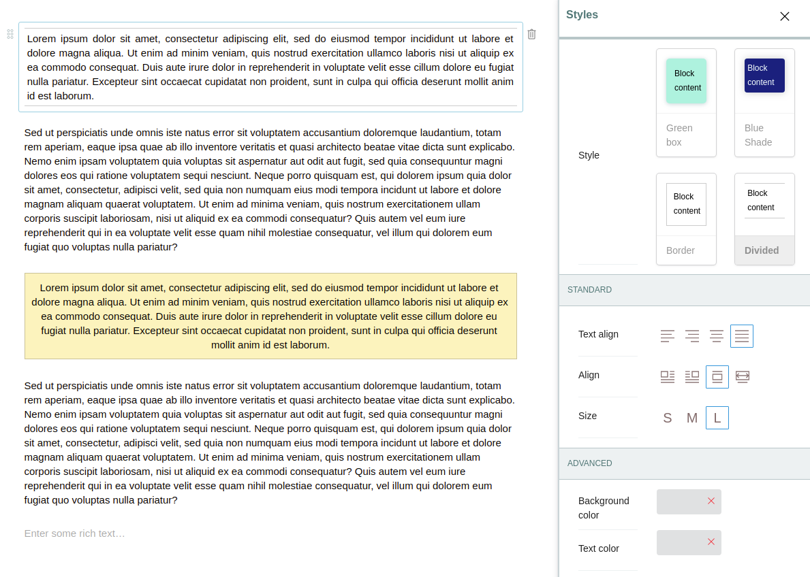
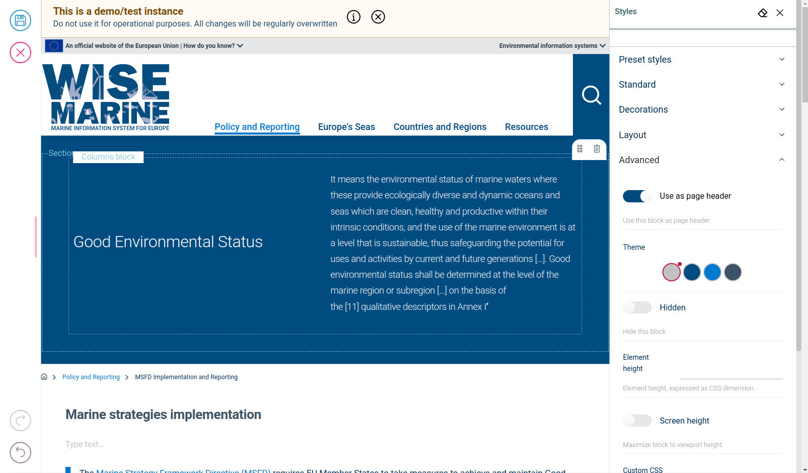

# @eeacms/volto-block-style

[](https://github.com/eea/volto-block-style/releases)
[](https://ci.eionet.europa.eu/view/Github/job/volto-addons/job/volto-block-style/job/master/display/redirect)
[](https://sonarqube.eea.europa.eu/dashboard?id=volto-block-style)

[Volto](https://github.com/plone/volto) add-on to style blocks and other components

## Features

A generic framework to style blocks and other components.

To configure it, set `settings.pluggableStylesBlocksWhitelist` as a list of
block types that you want to enable. By default it is enabled for all blocks.

#### IMPORTANT! Because of the way it works, you should always load this addon as the last addon in Volto project configuration.



From version 5.2.7 you can use blocks as page header by enabling 'Use as page header' from the 'Advanced' tab.



## Upgrade

### Upgrading to 10.x

> This version requires `Volto 18` or `Volto 19` and Node.js 22.

The block keeps the same API, so upgrading from 9.x on Volto 18 needs no code changes. The release adds Volto 19 support and moves the repository to the Volto 19 layout, where the published package lives in `packages/volto-block-style`.

#### Breaking changes

- **Node.js 22 or newer is required** (`engines.node >= 22`), 9.x declared no engine.
- **React 18 is required.** The package declares `react` and `react-dom` as `^18.2.0` peers, 9.x declared no peers.

The package also declares `react-portal` (`^4.3.0`), which it imports; 9.x relied on it being hoisted from the project.

## Requirements

### Backend

- [Plone](https://plone.org/download)
- [plone.restapi](https://pypi.org/project/plone.restapi/)

### Frontend

- Node.js: `>=22.0.0`

## Installation

1. Make sure you have a [Plone backend](https://plone.org/download) up-and-running at http://localhost:8080/Plone

   ```Bash
   docker compose up backend
   ```

1. Start Volto frontend

* If you already have a volto project, just update `package.json`:

   ```JSON
   "dependencies": {
       "@eeacms/volto-block-style": "*"
   }
   ```

   and `volto.config.js`:

   ```JavaScript
   const addons = ['@eeacms/volto-block-style'];
   ```

* If not, create one with Cookieplone, as recommended by the official Plone documentation for Volto 18+:

   ```
   uvx cookieplone project
   cd project-title
   ```

1. Install or update dependencies, then start the project:

   ```
   make install
   ```

   For a Cookieplone project, start the backend and frontend in separate terminals:

   ```
   make backend-start
   make frontend-start
   ```

1. Go to http://localhost:3000

1. Happy editing!

## License

See [LICENSE.md](LICENSE.md) for details.

## Funding

[European Environment Agency (EU)](http://eea.europa.eu)
